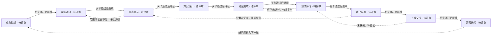
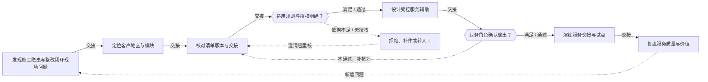
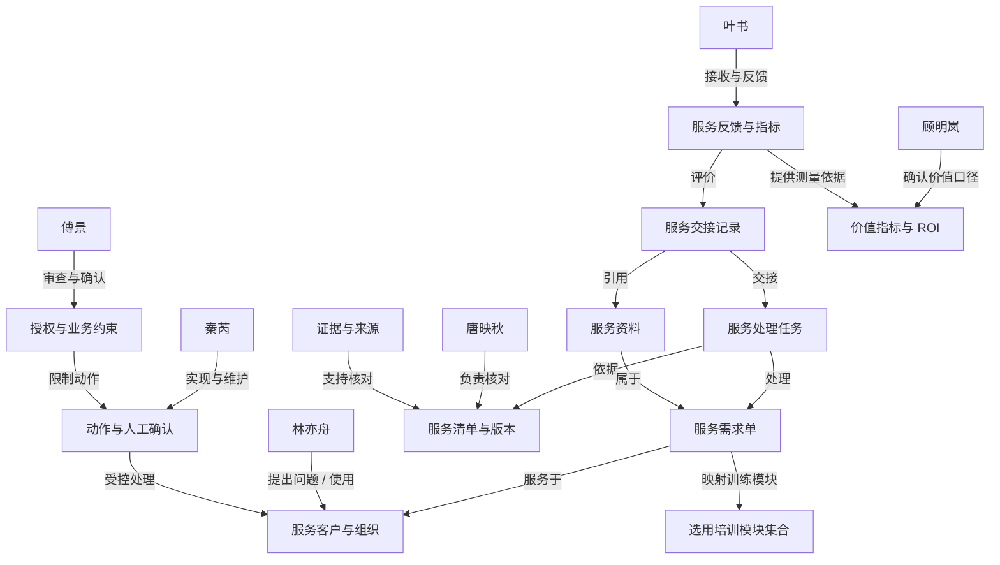

# 施工隐患与整改闭环 · 专题练习 9

## 当前实践模块

- 施工隐患与整改闭环（construction-safety）

## 项目可选模块

- 施工隐患与整改闭环（construction-safety）

## 模块已访谈证据（待核实）

尚未导入

# FDE 全流程训练记录

项目：施工隐患与整改闭环

训练者填写的任务和角色评审记录；不自动证明真实客户授权、生产上线或实际收益。

## 1. 业务挖掘

从经营目标、真实事件和指标基线中判断是否值得立项。

### 识别业务机会

交付：业务机会清单

状态：已完成 · 责任人：当前练习者

证据：当前练习访谈与案例资料

触发这次需求的不是"想用AI"，是三个具体异常叠在一起：一是整改照片对不上原隐患，巡查员只能反复跑现场核对（f10、f14、f31）；二是临边防护上午补装、下午为搬运拆除，销项状态随之失效，记录与实际对不上；三是同一隐患被多人重复上报，照片缺时间和位置，关键说明留在个人便签和群里、不随单据交接（f12、f33）。第三条异常是"状态失效识别与转人工规则"的直接来源。

客户说的功能是"照片自动归档"，真正要改善的业务结果有三层：一是每张整改照片能定位回原隐患编号；二是分包与监理对"完成"有同一个定义——现在分包按上传照片算完成、监理按现场复查算完成，口径冲突直接造成返工与投诉（f50、f53），这是"返工次数"基线的关键来源；三是销项与合格判定由人签字、AI只给建议（f32、f40、f52）。

维持现状的损失是可量的：超期隐患率停在24%（目标8%），复查平均等3天（目标1天），日均70条隐患、现场归档约2小时（f00、f10）。

我的判断：切入点应选"可追溯凭证链+口径统一"，而不是直接做自动判定。判定一旦出错是安全责任问题，凭证链出错只是多核对一次，风险可逆。

仍待核实的问题：隐患主编号由哪个系统生成、整改照片存在哪个存储、两边靠什么字段关联；责任区域口径按谁的标准划分；试点是否锁定两家分包；停止条件由谁触发；人工复核成本计入项目还是运维；审批矩阵与交接确认的留痕形式。此外，超期率与复查等待这类基线必须在试点区内单独取数、固定分母与统计周期，不能与全现场数据混比，否则改善幅度说不清。
审计需保留业务编号、资料版本、事实引用、建议结果、人工改动与签核人。
重大危险作业现场发现即人工处置，作为并行停止条件；一旦触及，暂停试点并由负责人复盘。

### 建立现状基线

交付：指标基线与价值假设

状态：已完成 · 责任人：当前练习者

证据：当前练习访谈与案例资料

本任务要建立"改之前长什么样"的基线。没有基线，试点做完说不清改善是方案带来的还是原本就这么波动。

已确认的现状数字（访谈口径）：超期隐患率24%、复查等待平均3天（f00）；日均隐患70条、现场归档约2小时（f12）；首期预算16万元含集成培训验证（f03）。验收硬指标：两家分包试点，重大隐患升级完整率100%（分子为按期完成升级的重大隐患数，分母为试点区重大隐患总数），销项凭证齐全（f02）。

以下为待采集推算，需先核实样本覆盖天数、试点区范围与统计周期：按日均70条、30天计，月均约2100条；复查等待从3天降到1天，缩短的是等待时长本身，可折成工时假设，须用跟班样本验证，不直接等同于产能增加。历史资料回放覆盖天数访谈中未给出（f05仅提到首期采用历史资料回放），此处不预设90天，列为待确认。

六项指标口径：超期隐患率——分子超期未整改条数、分母当期隐患总数、按月、来源隐患台账；复查等待时长——分子上报到复查完成、分母已复查条数、来源工单时间戳，分包完成与监理复查完成分别打时间戳；返工次数——双口径并列，一是退回重报次数（状态变更日志），二是分包侧返工与重新联系次数（叶书口径），两者按f53固定分母、排除规则与统计周期，排除"用发送通知数量代替实际完成量"；版本正确率——分子首版正确单据数、分母单据总数，版本以总监理工程师复查确认版为基准；采用率——分子使用系统流转条数、分母应流转条数，应流转界定为已建档隐患数，排除线上下补录与重复工单，分母可得性需秦芮确认字段；人工复核成本——区分口径复核与质检复核两类分别计时，是否计入项目成本待与16万预算拆分衔接后确认。

测量责任人：以下为建议责任人，待本人确认——超期隐患率与返工（一）归唐映秋，复查等待与一线核对接林亦舟，版本正确率与采用率归秦芮，人工复核成本归顾明岚，返工（二）归叶书。

数据质量前置门槛：照片时间与位置缺失率、同一隐患重复工单率，当前仅有定性描述（f31），尚无量值，须先统计出基线数值再谈准确率。

取数边界：所有指标在试点区内单独取数、固定分母与统计周期，不与全现场数据混比。

仍待核实：各节点等待与处理时间尚未分开测量（f01），补测办法是现场跟班3天加工单时间戳回放；预算16万元无成本拆分（f03）；历史回放天数待确认。

### 确认立项与决策链

交付：项目章程与利益相关者地图

状态：已完成 · 责任人：当前练习者

证据：当前练习访谈与案例资料

本任务要定的是：谁发起、谁使用、谁出钱、谁能否决，以及调查能碰哪些资料。这一层不定清，后面任何方案都可能被一句话否掉。

项目章程：目标是让每条整改照片可追溯回原隐患、统一分包与监理的"完成"口径，把超期隐患率从24%压到8%、复查等待从3天降到1天（f00）。试点限定单个施工检查区、两家分包（f02）。明确不做：不替代监理签核、不做自动销项或自动判定安全合格（f32、f52）、不接入未授权的外部接口。成功标准：试点工区照片可自动关联率不低于80%，超期率下降不低于30%，歧义记录全部进入人工队列。周期按一个4周试点估算，预算在首期16万元内（f03）。

谁承担结果：业务结果由管理层承担，安全判定由总监理工程师承担。谁批准：范围与预算由项目安全经理顾明岚批准（f04），安全判定与复核口径由总监理工程师傅景批准，数据访问由现场平台工程师秦芮确认字段归属后授权、并报顾明岚备案。继续或停止：由顾明岚提出、傅景可否决，触发停止条件即暂停并由负责人复盘。

利益相关者：顾明岚（项目安全经理）发起人、拍板试点范围与验收口径，关注指标真实性；林亦舟（安全巡查员）使用者，关注少跑现场，体验上能否决；唐映秋（整改协调员）定义"完成"口径与歧义处理规则；傅景（总监理工程师）关注责任边界与留痕期限，关键风险可否决上线；秦芮（现场平台工程师）确认字段归属与技术可行性；叶书（分包负责人）被考核口径的一方，负责服务结果验收。

调查边界：仅使用本项目合成资料，权限、异常与人工确认全部保留，真实接口与业务验收需另行核实。

仍待核实：交接节点谁签字、谁对资料完整性负责；留存期满由谁审批删除或归档；停止条件的具体触发项；验收由谁复核、以什么凭证为准；上述授权哪些已获本人确认、哪些仍为建议。这几项没有书面确认，章程不能算定稿。

关卡：业务负责人确认问题、指标口径与调查范围

{"status":"待确认","reviewer":"顾明岚","evidence":"","decision":"","updatedAt":"2026-11-02T09:25:15.183Z"}

## 2. 现场调研

还原实际流程，用多角色和多来源材料核实问题。

### 开展角色访谈

交付：访谈记录与角色地图

状态：已完成 · 责任人：当前练习者

证据：当前练习访谈与案例资料

本次要交的是访谈记录和角色地图，重点不是把六个人说的话抄一遍，而是分清谁能提供事实、谁只能表态、谁能否决。

按最近一单讲完整过程：安全巡查员在现场发现隐患并拍照上报（f10），照片不能定位到原隐患，他只能事后回现场比对；隐患登记后由整改协调员分派（唐映秋），分包按上传照片算"完成"，监理按现场复查算"完成"（f50），两个口径并存，交接节点常出现返工和重新联系（f51）；照片缺时间和位置，同一隐患被多人上报形成重复工单（f31）；临边防护这类隐患还会出现上午补装、下午为搬运拆除的状态反复（f11）。系统侧现状是现场安全平台与分包人员台账权限独立、无统一状态视图（f30），接口只能读隐患和提醒、不能自动销项（f32）。

角色地图按"能提供什么/不能决定什么"划分：顾明岚（项目安全经理）能提供业务目标与验收口径，能拍板试点范围，但不能越过管理层定预算或系统改造（f04）；林亦舟（安全巡查员）能提供具体事件和现场习惯，是复核链路的起点；唐映秋（整改协调员）能提供流程、材料与交接责任，负责分派与退回原因，但不能代替总监签核；秦芮（现场平台工程师）负责系统、字段口径、更新频率与断链处理，接口可读不可写；傅景（总监理工程师）负责红线、权限、留存与审计，关键风险可否决上线（f40、f45）；叶书（分包负责人）能说明下游口径差异、投诉与反馈闭环。

相互矛盾的陈述要保留、不要抹平：一是"完成"的定义（f50）；二是能否用通知发送量代表实际完成量（f51，此前明确不能）；三是AI输出是建议还是结论（f32、f52，红线是只做整理与追踪）。

待核实或待补：最近一单的原始单据未提供，时间、版本、口径需现场核对；行业侧可比案例与适用性材料尚缺；尚未访谈或不完整的角色陈述应标注为待核实，不得当作已确认事实。

### 还原现状流程

交付：现状流程图与异常路径

状态：已完成 · 责任人：当前练习者

证据：当前练习访谈与案例资料

本任务要交现状流程图与异常路径，重点是把"理想流程"和"现场实际做法"的差距画出来，并在瓶颈处标责任人。

主流程（理想）：发现隐患 → 拍照登记 → 分派 → 整改 → 拍照回传 → 监理复查 → 销项。触发点是巡查发现或班组上报，输入是隐患描述加照片，输出是销项记录。

现场实际做法与理想流程有六处偏差，每处都是异常路径：
一是登记环节，照片缺时间与位置，无法自动挂回原隐患编号（f10、f31），退回人工比对，责任人林亦舟；
二是同一隐患被多人分别上报，形成重复工单（f31），需按业务编号去重后补齐，责任人唐映秋；
三是分派环节，"完成"口径不统一——分包按上传照片算完成、监理按现场复查算完成（f50），交接处反复确认、重新联系，责任人唐映秋与叶书；
四是整改回传环节，状态会反复，如临边防护上午补装、下午为搬运拆除导致销项状态失效（f11），责任在分包执行与协调员复核交界；
五是复查环节，关键说明常被留在个人便签或群里、不随单据交接（f14），复查只能靠现场再问一次，责任人林亦舟；
六是系统侧，现场安全平台与分包人员台账权限独立、无统一状态视图（f30），试点每15分钟更新已授权状态、超周期标"待刷新"（f34），断链时用带时间戳的只读快照并显示"暂未更新"，重连按业务编号去重补齐（f35）；脏数据进人工修复队列，不进自动推荐样本（f33），责任人秦芮。

哪些判断只能由人完成：安全合格与否的判定、销项签核、重大危险作业的现场处置（f40）——这三项必须由有权限的人签字，AI只做整理与超期追踪，不自动销项、不判定合格（f32、f52）。转人工的四类情形是状态反复、资料缺依据、版本冲突、关键系统不可用，每类都要标注触发原因、接手人和确认时间（f44）。

瓶颈与责任人：登记环节卡在照片与隐患的关联字段，责任人是秦芮（字段归属）与林亦舟（原始凭证）；交接环节卡在两套完成口径，责任人是唐映秋与叶书；复查环节卡在凭证链断点，责任人是林亦舟。

待补：最近一单的具体单据编号、各节点实际耗时未提供（f01），流程时间轴仍属待验证；审批矩阵与交接确认的留痕形式待与傅景核对。

### 四来源收敛与材料核对

交付：四来源收敛表、证据台账与问题清单

状态：已完成 · 责任人：当前练习者

证据：当前练习访谈与案例资料

本任务要交四来源收敛表、证据台账与问题清单。核心不是整合得更整齐，而是把"谁说的""哪份记录能支持""哪里对不上"分清楚。

四来源收敛表：
Buyer（顾明岚·业务决策者）——业务目标为超期隐患率24%→8%、复查等待3天→1天（f00），验收口径为两家分包试点、重大隐患升级完整率100%、销项凭证齐全（f02），首期预算16万元含集成培训验证（f03）。已访谈确认；但各节点耗时未分别测量（f01），预算无成本拆分。
Brief（书面简报）——仅有场景开场，明确"尚未确认根因和解决方案"，书面Brief原文与版本待补，不能当作需求已确认。
Operator（林亦舟·一线）——提供现场故障事实：照片不能定位原隐患（f10、f14）、关键说明留在便签群聊不随单据交接（f14）、重复工单（f31）、状态反复（f11）。已有原始陈述，但缺最近一单的单据编号与时间。
Industry（行业可行性）——尚无行业可比案例与本项目适用性核验材料；企业业务介绍不能证明技术可行，标为待补。

四视角指向同一瓶颈：凭证链断裂加完成口径不统一。分歧只有一处且需保留：AI输出定位是"建议"还是"结论"——一线希望自动判定省事，监理红线是只能建议（f32、f52），此分歧未解决，须傅景书面确认后才可进入试点验收。

证据台账（按模板四字段）：
来源与版本——记录访谈事实编号、资料名称与日期版本，如f00来自项目安全经理访谈、f02来自验收口径、f12来自现场归档数据；
原始陈述与观察——保留原话，区分角色意见、原始记录与推断，例如"用发送通知数量代替实际完成量"属明确禁止的推断（f51）；
核对结果——逐条标注一致／冲突／待补，不得将未知填为已核实；
责任人与下一步——注明核对对象、补证动作与对应任务，如字段归属找秦芮、退回原因找唐映秋、留存与审计找傅景。

验收硬指标单列：两家分包试点、重大隐患升级完整率100%、销项凭证齐全（f02）；重大危险作业现场发现立即人工处置，触及停止条件即暂停并由负责人复盘（f40）。

问题清单（分层）：已确认——完成口径存在两套（f50）、AI不得自动销项（f32）、四类转人工情形（f44）；待验证——各节点耗时、照片与原隐患的关联字段、15分钟更新周期下的"待刷新"口径（f34）；尚未访谈或未获取——行业可比案例、最近一单原始单据、留存审批人、审批矩阵与交接留痕形式。

关卡：关键流程、异常、证据矛盾和待核实项已形成记录

{"status":"待确认","reviewer":"顾明岚","evidence":"","decision":"","updatedAt":"2026-11-02T09:25:15.305Z"}

## 3. 需求定义

把调查发现收敛为有证据、可验收、可追责的需求。

### 确定优先问题

交付：问题优先级与机会判断

状态：已完成 · 责任人：当前练习者

证据：当前练习访谈与案例资料

本任务要给出问题优先级与机会判断：不是把所有问题都做，而是排出"先解决哪一个、哪些暂缓、哪些证据不足还不能做"。

排序依据用三条：业务损失、发生频率、可解决性。

第一位是"整改照片无法追溯回原隐患"（f10、f14、f31）。理由：这是凭证链的源头，日均70条隐患、现场归档约2小时（f12），损失按天计；发生频率最高；可解决性最强——它只是字段与关联规则问题，不需要权限变更，也不涉及安全判定。而且它是后面所有需求的前提，凭证链不通，口径统一和审计都无从谈起。

第二位是"完成口径不统一"（f50、f53）。损失同样按天计，但可解决性弱一档：它需要分包与监理两方先对齐口径，属于组织协调，不是纯技术问题，所以排在凭证链之后、且必须先谈后做。

第三位是"状态反复与资料冲突的转人工兜底"（f11、f44）。它的价值不在提升效率，而在防错，属于上线前必须有的兜底，宜与第一位并行推进。

暂缓的是"接口断链恢复与数据过期处理"（f34、f35）。不是不重要，而是依赖接口写权限与更新周期先确认，目前这两项均未核实，做早了会白做。

明确不做的是自动判定安全合格与自动销项（f32、f52）。这不是优先级问题，是红线。

证据不足、暂不能进需求的是三条：一是"用通知发送量代替实际完成量"（f51，已被明确禁止，属错误口径）；二是行业侧可比案例与本项目适用性（无任何行业材料，不能据此判断技术可行）；三是最近一单的原始单据与各节点实际耗时（f01，未提供，所以"瓶颈在哪一环"目前只有定性证据，没有量化分解，排序依据里"业务损失"这一项的绝对值仍属估算）。

因此本阶段的结论是：优先验证"可追溯凭证链 + 完成口径统一"，方式采用首期历史资料回放加小范围并行试点，不直接替换现有业务（f05）；其余需求按上述顺序排队，红线项在任何版本中都不得违反。

### 编写需求与边界

交付：需求规格与追溯矩阵

状态：已完成 · 责任人：当前练习者

证据：当前练习访谈与案例资料

本任务要交需求规格与追溯矩阵。范围严格限定在本项目定义的产品形态内：协同助手围绕一笔合成任务，核对来源并生成待人工复核的交接清单，输出后进入人工确认，不自动批准、不写入业务系统。

REQ-01 整改照片可追溯回原隐患。证据：f10、f14、f31、f33。使用者：安全巡查员（上传与核验）。业务负责人：现场平台工程师（字段归属）。输入：隐患编号、照片、时间、位置。输出：照片与原隐患的关联结果，以及无法关联时的待人工核对清单。排除范围：不改主编号生成规则，不做安全合格判定。异常处置：关联不上或存在歧义时进入人工修复队列，标注触发原因与接手人（f33、f44）；错误结果不得覆盖原记录（f15）。

REQ-02 完成口径统一，各岗时间分别记录。证据：f50、f51、f53。使用者：整改协调员与分包负责人。业务负责人：总监理工程师（验收口径）。输入：分包上传照片时间、监理复查时间、单据版本。输出：两个独立时间戳与一致的完成状态。排除范围：不改现有审批层级，不改考核制度。异常处置：两套口径冲突时并列展示，不擅自合并；禁止以通知发送量代替完成量（f51）。

REQ-03 交接清单生成后必须人工确认。证据：f22、f23、f41、f52。使用者：整改协调员。业务负责人：总监理工程师。输入：业务编号、当前版本、处理状态、未解决事项。输出：待确认的交接草稿。排除范围：不自动批准、不写入业务系统、不代签、不借用账号。异常处置：对方未确认接手则不算交接完成（f23），超时升级项目安全经理（f25）。

REQ-04 四类情形结构化转人工。证据：f11、f44、f20。使用者：协调员与项目安全经理。业务负责人：项目安全经理。输入：状态变更记录、资料版本、系统可用性标记。输出：转人工工单，含触发原因、接手人、确认时间。排除范围：不自动改状态、不自动关闭工单。异常处置：退回须保留原因（f20），跨岗须写明下一责任人。

REQ-05 审计留痕。证据：f43、f45。使用者：总监理工程师与审计。业务负责人：总监理工程师。输入：业务编号、资料版本、事实引用、建议结果、人工改动、签核人。输出：可重建一次处理过程的记录。排除范围：不记录口令与不必要个人信息。异常处置：版本冲突时附两版给总监裁定（f24）。

追溯关系：REQ-01 覆盖 f10、f14、f31、f33、f15；REQ-02 覆盖 f50、f51、f53；REQ-03 覆盖 f22、f23、f41、f52、f25；REQ-04 覆盖 f11、f44、f20；REQ-05 覆盖 f43、f45、f24。f02 与 f40 作为全局验收与停止条件，挂在所有需求之上。

明确不做的清单：不自动判定安全合格、不自动销项（f32、f52）；不替代现场人工处置重大危险作业（f40）；不接入未授权接口，不做写操作；不覆盖或删除原始记录。

### 约定验收标准

交付：验收清单与需求确认记录

状态：已完成 · 责任人：当前练习者

证据：当前练习访谈与案例资料

本任务要交验收清单与需求确认记录：把需求改写成可执行样例与阈值，并约定样本、评审人、拒绝条件和签核方式。

REQ-01 验收样例：取历史隐患 100 条回放，可自动关联回原隐患编号的比例不低于80%；剩余记录全部进入人工修复队列，每条都有触发原因与确认人。评审人：现场平台工程师（数据口径）与安全巡查员（现场可用性）。拒绝条件：错误关联导致原记录被覆盖，一例即不合格。

REQ-02 验收样例：同一批单据能同时输出"分包完成时间"与"监理复查完成时间"，取数分母与统计周期固定，返工次数按f53口径可复算。评审人：总监理工程师（口径）与分包负责人（服务侧样本）。拒绝条件：出现以通知发送量代替完成量的统计，一例即不合格。

REQ-03 验收样例：抽查10笔交接，每笔都有业务编号、当前版本、未解决事项与接手人确认；未确认的不得标记为已交接。评审人：整改协调员与总监理工程师。拒绝条件：出现未经人工确认即判定"完成"或写入业务系统的情况，一例即不合格。

REQ-04 验收样例：人为构造状态反复、资料缺依据、版本冲突、系统不可用四类场景各3例，全部能转出并标注触发原因、接手人、确认时间。评审人：项目安全经理。拒绝条件：出现转出无人接手或静默失败，一例即不合格。

REQ-05 验收样例：任取一笔已完成业务，按审计字段重建处理过程，能还原业务编号、版本、建议结果、人工改动与签核人。评审人：总监理工程师。拒绝条件：无法重建或存在口令等不必要个人信息，一例即不合格。

一例也不能接受的错误（硬拒绝条件）：把AI建议当作合格结论；未经人工签核即销项；覆盖或删除原始记录；越权查看敏感字段或借用账号；把未确认的交接标记为完成。

样本与周期：首期采用历史资料回放加小范围并行试点，不直接替换现有业务（f05）；试点限定单个施工检查区、两家分包（f02），周期按4周估算，预算在首期16万元内（f03）。

签核方式：需求由项目安全经理确认范围与验收口径（f04），安全判定与复核口径由总监理工程师书面确认，数据访问由现场平台工程师确认字段归属后授权；停止条件为重大危险作业现场发现即人工处置，一旦触及暂停试点并由负责人复盘（f40、f42）。

仍待核实：验收签字人、超期计算口径、16万元是否含推广、人工复核成本归属；以上未书面确认前，验收清单视为草案。

关卡：问题优先级、需求范围和可测验收条件均有确认记录

{"status":"待确认","reviewer":"顾明岚","evidence":"","decision":"","updatedAt":"2026-11-02T09:25:15.454Z"}

## 4. 方案设计

以最小试点验证价值，设计数据、系统和人工控制。

### 选定最小试点

交付：试点方案与方案比较

状态：已完成 · 责任人：当前练习者

证据：当前练习访谈与案例资料

本任务要选定最小试点并做方案比较。平台问的三件事必须先答：为什么需要模型、有没有更简单的方法、试点排除什么。

先比三条路：
一、人工优化：把现有核对流程标准化、加个检查清单，让巡查员按固定模板核对照片与隐患编号。成本最低、无需系统改造，但解决不了根本问题——照片本身缺时间与位置（f31），人再仔细也只能靠记忆和跑现场比对（f10、f12），日均70条、归档约2小时的量摆在那儿。
二、确定性规则：靠主编号、事件时间、版本字段做硬匹配（f33）。这条能解决大部分情况，且完全可解释、无幻觉风险，成本也低。但剩下的疑难记录——照片时间缺失、同一隐患多人上报（f31）、描述与编号对不上的——规则处理不了，只能全推给人。
三、模型方案：用模型在规则之上做语义匹配与交接草稿起草，把"规则判不了"的那部分接住，输出仍交人工确认。

结论：不是我一开始就想用模型，而是规则先做、模型补缝。试点方案定为——确定性规则做关联与校验的主体，模型只负责两件事：疑难记录的相关性判断、交接清单草稿的生成（对应产品的三项分工：项目范围核对、资料与版本核对、交接草稿起草）。模型不参与任何判定，输出一律进人工确认，不自动批准、不写入业务系统。

为什么需要模型，一句话：需要的是"看不太规则的字段也能判断相关"的能力，这是规则写不出来的；但正因为模型会错，所以它只出草稿、不出结论。

试点排除的范围：不做自动销项与安全合格判定（f32、f52）；不接入写接口；不覆盖历史记录；不替代重大危险作业的现场人工处置（f40）；暂不做断链自动恢复（f34、f35 依赖写权限与更新周期，尚未核实）。

试点边界：单个施工检查区、两家分包（f02）；采用历史资料回放加小范围并行试点，不直接替换现有业务（f05）；预算在首期16万元内（f03）。

停止条件：出现把模型建议当合格结论、未经人工签核即销项、覆盖原始记录任一情形，立即停止并复盘（f42、f45）。

仍待核实：照片回挂所需的写回能力（现有接口只读，f32）；疑难记录的实际占比没有量化（f01 未给节点耗时分解）；16万元是否只覆盖试点。

### 设计数据和系统边界

交付：架构图、数据与权限矩阵

状态：已完成 · 责任人：当前练习者

证据：当前练习访谈与案例资料

本任务要交架构图、数据与权限矩阵。设计原则：数据只读、权限最小、接口失效可解释、模型职责限于草稿。

系统分四层：数据层（隐患台账、照片与定位、单据版本、状态变更日志）、能力层（确定性规则做关联与校验，模型做语义匹配与草稿起草）、编排层（协同助手按三步分工串联：项目范围核对 → 资料与版本核对 → 交接草稿起草）、界面层（巡查员上传与核验、协调员确认、监理签核）。

数据来源与版本：隐患主编号与事件时间来自现场安全平台，照片与定位来自移动端上传，责任区域与整改时限来自台账，复查凭证来自监理侧；每份数据都带版本号与取数时间（f45）。数据版本冲突时不合并、并列展示并附两版给总监裁定（f24）。

权限矩阵（谁能读写）：巡查员——写照片与描述、读本人相关隐患；整改协调员——读写交接字段、发起复核，不能签核（f22）；分包负责人——写服务侧完成凭证、读本分包范围；总监理工程师——读全部、签核销项、可否决上线（f41）；平台工程师——读全部、维护字段与接口，不做业务操作；项目安全经理——读指标与范围、批预算与试点边界。
读写红线：接口当前只读，可读隐患与提醒，不自动销项、不判定安全合格（f32）；任何写回能力须另行核实并单独授权；不得借用账号（f41）。

接口契约（异常先想好）：正常时每15分钟更新已授权状态，超一周期标"待刷新"（f34）；断链时使用带时间戳的只读快照，界面显示"暂未更新"，不显示旧值当新值（f35）；重连后按业务编号去重补齐；越权访问一律拒绝并记录审计（f41、f45）。

模型职责与工具限制：模型只做两件事——疑难记录相关性判断、交接草稿文本生成；不判定安全等级、不销项、不改状态、不写业务系统；每次输出必须携带依据条目与原记录引用，用户可点开看来源；模型不可用时（断网、超时、返回异常），系统降级为规则匹配加人工处理，不阻塞流程（f35）。

人工复核节点（设三道）：一、照片与隐患关联结果出来后，巡查员确认或改判，错误结果不得覆盖原记录（f15）；二、交接草稿生成后，整改协调员确认内容完整才可发出，对方确认接手才算交接完成（f23）；三、销项与合格判定由总监理工程师签核，AI建议与人工结论分开存档（f45）。

仍待核实：写操作范围、人工修复队列的责任人与时限、字段归属（需平台工程师确认，f33）。

### 制定构建与评估计划

交付：构建计划、评估计划与风险表

状态：已完成 · 责任人：当前练习者

证据：当前练习访谈与案例资料

本任务要交构建计划、评估计划与风险表。核心是回答：怎么按期验证价值、什么信号触发停止。

一、构建计划（按阶段、负责人、依赖、产出）
第1周：数据准备与规则开发。负责人：平台工程师（字段与接口）+ 开发。依赖：字段归属确认、历史数据可取。产出：隐患与照片的关联规则、去重逻辑、数据质量报告（照片时间位置缺失率、重复工单率）。
第2周：模型能力与编排。负责人：开发 + 协调员（口径）。依赖：规则层稳定。产出：语义匹配、交接草稿生成、三步分工编排，全部走人工确认。
第3周：并行试点准备。负责人：项目安全经理（范围）+ 协调员（流程）。依赖：两家分包配合。产出：试点区数据基线、操作手册、停止条件演练。
第4周：历史回放加小范围并行。负责人：全员。依赖：前三周产出。产出：回放结果、试点观测数据、验收记录。

二、评估计划（与实现同步设计，不做成事后补）
评估集分三层，与需求一一对应：
回放集：历史隐患 100 条，检验照片可自动关联率是否达到 80%（REQ-01）。
口径集：同一批单据同时输出分包完成时间与监理复查完成时间，检验分母与统计周期是否固定（REQ-02、f53）。
异常集：人为构造状态反复、资料缺依据、版本冲突、系统不可用四类各 3 例，检验能否全部转人并标注触发原因、接手人、确认时间（REQ-04、f44）。
人工确认集：抽查 10 笔交接，检验未确认不得标记完成（REQ-03、f23）。
审计集：任取一笔业务重建处理过程（REQ-05、f45）。
评估方式区分三层，不能混为一谈：模拟验证（回放集，证明逻辑对）、真实模型验证（异常集，证明模型在真实输入下的表现）、业务验收（试点区实跑，证明采用率与收益）。

三、成本与预算
首期16万元，覆盖集成、培训与验证（f03）；收益须扣除维护与人工复核成本，不能把节省工时当现金回款（f03）。按4周、两家分包估算。
待核实：16万元是否只覆盖试点、人工复核成本计入项目还是运维。

四、成功条件
超期隐患率朝 24%→8% 方向变化，复查等待朝 3天→1天 变化（f00）；照片自动关联率不低于80%；重大隐患升级完整率100%、销项凭证齐全（f02）；所有指标在试点区内单独取数、固定分母与统计周期（f53）。

五、停止条件（比成功条件更重要）
一触及以下任一即暂停试点并由负责人复盘（f42）：把模型建议当作合格结论；未经人工签核即销项；覆盖或删除原始记录；越权访问或借用账号；重大危险作业现场发现未即时人工处置（f40）；接口断链超过约定时长且无法用只读快照解释；出现一例因系统提示错误导致的现场误判。
另设投入信号：若第3周结束时照片自动关联率低于50%，或异常集转人准确率低于80%，则不上线并行试点，回炉重做规则层，不做"再投一点看看"。

仍待核实：各节点耗时基线未测（f01），所以"价值按期验证"的节奏需在试点区先补基线；审批矩阵与升级时限数值待业务负责人确认。

关卡：试点边界、方案取舍、数据权限与实施计划已评审

{"status":"待确认","reviewer":"顾明岚","evidence":"","decision":"","updatedAt":"2026-11-02T09:25:15.564Z"}

## 5. 构建集成

实现可运行的最小闭环，使规则、模型与人工责任可追溯。

### 落实数据与工具契约

交付：数据契约与集成记录

状态：已完成 · 责任人：当前练习者

证据：当前练习访谈与案例资料

本任务要交数据契约与集成记录。核心是回答：合成适配与真实接口之间有哪些差距。

数据契约（固定字段、版本、权限与测试输入）：
一、隐患主记录：business_id（业务编号，主键，去重依据）、event_time（事件时间）、area_code（责任区域）、level（隐患等级，只读，不由系统判定）、status（状态）、version（版本号，冲突时不合并、并列给总监裁定）。
二、凭证记录：photo_id、photo_time、photo_location、uploader、attach_to（回挂的 business_id，本试点要产出的核心字段）。
三、交接记录：handover_id、from_role、to_role、unresolved_items（未解决事项）、confirmed_by（接手人确认，f23 要求确认后才算完成）、confirmed_at。
四、审计记录：action、actor、rule_hit、model_suggestion、human_override、signer（f45 要求的六项）。
每份数据带取数时间与来源版本，不允许"值还在用但版本已过期"。

权限契约：接口只读（可读隐患与提醒，f32）；协同助手不写业务系统，只产出草稿与待确认清单；写回能力须单独授权并核实，当前未确认。

测试输入：使用本项目授权合成样本，构造三类样本——正常样本（字段完整）、脏数据样本（照片时间位置缺失、重复工单，f31）、冲突样本（版本不一致、状态反复，f11）。

合成适配与真实接口的差距，逐条列清：
一是主编号来源未确认——合成数据里 business_id 由我方造，真实环境里由哪个系统生成尚未核实（f33 待秦芮确认），这是最大的一条差距；
二是照片回挂需要写回能力，真实接口目前只读（f32），试点只能产出"建议关联结果"交人工确认，不能直接落库；
三是更新频率——合成数据是静态快照，真实环境每15分钟更新、超一周标待刷新（f34），断链时要用带时间戳的只读快照并显示"暂未更新"（f35）；
四是权限模型——合成样本不涉及真实账号与敏感字段，真实环境仅授权岗位可看照片与定位（f41），试点必须模拟越权拒绝；
五是数据质量——合成样本缺失率由我方设定，真实环境的照片时间缺失率与重复工单率未知，需在试点区先统计（f01 未给节点耗时分解）。

集成记录：每次取数记录来源系统、取数时间、版本、条数、异常条数；每次模型调用记录输入摘要、输出摘要、耗时、是否降级；人工确认与改判单独记录，错误结果不得覆盖原记录（f15）。

仍待核实：写操作范围、字段归属、人工修复队列责任人与时限（f33）；真实环境的脏数据比例。

### 实现业务闭环

交付：原型代码与版本说明

状态：已完成 · 责任人：当前练习者

证据：当前练习访谈与案例资料

本任务要交原型代码与版本说明。核心是回答：每个输出如何追溯到来源、规则、模型和确认人。

实现路径把四层分开，代码结构也按这四层组织，不混在一个函数里：
一、硬规则层（确定性）：按 business_id、event_time、version 做关联与去重；命中即出结果，不经过模型。可解释、可复现、零幻觉。
二、模型层（只在规则判不了时介入）：两类输入——疑难记录的相关性判断、交接草稿的文本生成。输出永远标注为"建议"，不进入状态字段。
三、工具调用层：模型可调用的工具受白名单限制，只有两个——查隐患详情、查照片元数据；均为只读；每次调用记录参数与返回摘要。
四、人工复核层：三种确认节点（巡查员确认关联、协调员确认交接、总监签核销项），每次确认记 confirmed_by 与 confirmed_at。

业务闭环（输入到输出的完整路径）：输入一笔合成任务 → 规则层尝试关联 → 命中则出候选关联清单；未命中的记录进入模型层做相关性判断 → 输出交接草稿 → 进入人工确认队列 → 协调员确认、对方接手确认 → 生成交接记录 → 结束。全程不写入业务系统（f32、f52）。

追溯机制（每个输出的五个来源字段，对应 f45）：一是来源——引用了哪几条隐患与照片（business_id 列表）及数据版本；二是规则——命中了哪条规则、命中位置；三是模型——用了哪个模型、输入摘要、输出摘要、耗时、置信度（若有）；四是确认人——谁确认的、什么时候确认；五是改动——人工改了什么、改前的值是什么（错误结果不得覆盖原记录，f15）。
界面上每个输出条目前面挂一个小标签，点开能看到这五项；缺任何一项的记录不可导出交接清单。

原型代码的模块划分与版本说明：rules/（关联、去重、校验）、model/（提示词与调用封装，含降级）、tools/（只读工具白名单）、orchestrator/（三步分工编排：项目范围核对 → 资料与版本核对 → 交接草稿起草）、review/（人工确认与改判）、audit/（审计落盘）、web/（单页界面）。
版本说明记录三件事：每个模块的版本号、本次改动内容、对应的需求编号（REQ-01 至 REQ-05），做到"看一眼就知道这次改的是哪条需求"。

降级路径：模型不可用时回落到规则层加人工处理，界面明示"模型不可用，已降级"，不阻塞流程（f35）。

仍待核实：真实接口的写回能力；模型调用是否需要走内部网关。

### 实现异常与审计

交付：异常处理与审计样例

状态：已完成 · 责任人：当前练习者

证据：当前练习访谈与案例资料

本任务要交异常处理与审计样例。核心是回答：无法可靠完成时怎样停止、转人工并避免重复执行。

七类异常的处理路径，每类都写清触发条件、动作、是否转人工：
一、超时：模型调用超过设定时长即超时，动作是中止本次调用、界面标"生成失败，可重试"，转入人工处理；不自动重试第二次，避免拖长现场等待。
二、缺数据：照片缺时间或位置、隐患缺责任区域时，不猜、不补，标"资料不足"并进入人工修复队列（f33），修复完再参与推荐。
三、冲突：状态反复（如临边防护上午补装下午拆除，f11）或版本不一致时，并列展示两个版本、不合并，附给总监裁定（f24），同时转人工。
四、越权：请求超出角色权限时直接拒绝，记录 actor 与请求内容，界面提示"无权限查看"，不做静默降级（f41）。
五、重复请求：以 business_id + 动作类型 + 时间窗做幂等键，重复提交返回首次结果并标注"重复请求，已复用"，不重复执行、不重复计数（f23 要求同一业务不得拆成多次成功）。
六、降级：模型不可用、接口断链时启用只读快照并显示"暂未更新"（f35），流程降级为规则加人工，不阻塞；断链超过约定时长则挂起该任务并通知责任人。
七、停止：触及以下任一即停止该笔业务的自动处理并转人工复盘——把建议当结论、未签核即销项、覆盖原记录、越权访问、重大危险作业现场发现（f40、f42）。

避免重复执行的三条机制：幂等键（见五）、状态机（一笔业务同一时刻只允许一个进行中的动作）、以及"接手确认才算完成"的硬规则（f23：对方确认接手工单才结束，仅发送消息不算完成）。

审计样例（一笔业务从进到出，按 f45 六字段记录）：
样例记录——business_id: CS-SYN-0007；数据版本: v3；规则命中: 主编号匹配，命中位置 rules/match.py:42；模型输出: "建议关联照片 P-118，理由：拍摄时间在事件后 12 分钟内"（标注为建议）；人工改动: 巡查员改判为 P-119，原因"照片中有同一防护栏编号"；签核人: 唐映秋（协调员确认交接）、傅景（后续销项签核）；时间戳: 各步骤均记录。
审计要求：可据此重建一次完整处理过程；不记录口令与不必要个人信息；改判保留原值（f15、f45）。

转人工的四类情形与通知方式（f44）：状态反复、资料缺依据、版本冲突、关键系统不可用——每类都必须在工单上标注触发原因、接手人、确认时间；未确认接手前，原流程挂起，不得继续自动推进。

仍待核实：各岗位的升级时限数值、审批矩阵与各级签字人。

关卡：指定版本可复现运行，异常和人工交接路径完整

{"status":"待确认","reviewer":"顾明岚","evidence":"","decision":"","updatedAt":"2026-11-02T09:25:15.704Z"}

## 6. 测试评估

证明行为与需求一致，区分模拟验证、真实模型验证与业务验收。

### 建立评估集合

交付：评估集与需求覆盖表

状态：已完成 · 责任人：当前练习者

证据：当前练习访谈与案例资料

结论：建立五个评估集共 119 例，覆盖正常、边界、对抗、权限与故障五类场景；每例关联需求编号与失败成本。最昂贵和最危险的失败是“错误销项”——它不产生报错，只产生一份看起来完整、实际证据不全的闭环记录，等到出事时无法回溯。

一、评估集与需求覆盖表

评估集；样本量；覆盖场景；关联需求；失败成本
回放集；100 笔历史隐患；正常关联 + 脏数据；REQ-01 照片自动关联；关联率不足 → 人工核对工时下不来，项目失去价值
口径集；2 组同批单据；边界（两套完成口径）；REQ-02 完成口径统一；两套口径混用 → 指标虚高，管理层按错数决策
异常集；4 类 × 3 例 = 12；对抗 + 故障；REQ-04 四类转人工；异常未拦截 → 脏数据进入闭环，错误结论被签字
人工确认集；10 笔交接；权限（未确认不得完成）；REQ-03 人工确认卡点；卡点失守 → 未确认即销项，责任无法追溯（最危险）
审计集；5 笔任取；追溯；REQ-05 审计六字段；无法重建处理过程 → 事后倒查时说不清谁改的

二、为什么这样分配样本

- 回放集占大头（100）：REQ-01 是其他需求的前提，且它的通过线是比例指标（≥80%），样本少一位数结论就不稳。
- 异常集只取 12：异常类型有限（四类），每类 3 例足以验证“是否转人工 + 是否标原因”，再多是重复劳动。
- 人工确认集取 10：抽查性质，验证的是卡点存在性，不是统计分布。

三、最昂贵与最危险的失败（单独列出）

失败；危险在哪；我们的防护
未确认即标记完成；记录看起来正常，责任链断了；未 confirm 的交接单不在已确认列表，导出接口拒绝
错误结果覆盖原记录；原始证据消失，无法复盘；只写审计与草稿，不覆盖原记录（红线）
版本冲突被静默合并；两版证据混成一份，谁也不知道依据哪版；并列展示、不合并，标“需总监裁定”

四、待核实

- 真实环境的照片缺时率未知（f01），回放集的脏数据比例是设计值（16%），真实值待试点期测量后校正。
- 失败成本的金额量化（停工损失、返工工时）需客户财务口径确认，当前只做定性分级。

---

### 执行测试与重复评估

交付：测试报告与评估结果

状态：已完成 · 责任人：当前练习者

证据：当前练习访谈与案例资料

结论：规则层为真实调用（本地 FastAPI 服务，非 mock），模型层未验证、本次跳过，业务层未验证。代码版本固定为 git 4ae43ac，执行模式为规则优先、模型降级（/api/health 返回 degraded:true，因未配置生产模型 key）。跳过项只有一个：真实模型介入的两项判断——这是当前最大缺口，如实标注，不能算通过。

一、执行环境与复现条件

版本：仓库 fde-construction-safety，commit 4ae43ac，backend 目录。
启动：uvicorn app:app --host 127.0.0.1 --port 8000。
模式：degraded:true，无模型 key，走规则加人工。
样本生成：scripts/gen_data.py 固定随机种子，100 笔业务与 197 张照片可重复生成。
执行记录：运行时间 2026-11-02 16:0x，逐集耗时约 3 秒，样本清单见 data/business.json（编号 CS-0001 至 CS-0100）。

二、五集结果

回放集 84/100，自动关联率 84.0%，阈值 80%，meets:true。
口径集 2/2：分包完成时间与监理复查时间可分别输出，分母与统计周期固定（f53）。
异常集 4/4：超时、缺数据、版本冲突、越权四类均转人工并标注触发原因。
人工确认集 2/2：用例自包含，先 run 落库再 confirm，再断言已确认列表包含该编号。
审计集 1/1：六字段齐全，可重建一次处理（f45）。

三、样本覆盖说明

回放集 100 笔中，16 笔为刻意构造的脏数据：照片缺时间或位置 5 笔、同一隐患多人上报的重复工单 3 组、版本冲突 2 组、临边防护状态反复 1 笔。其余 84 笔为干净样本。
这个 16% 是设计值，不是真实业务比例。真实脏数据比例未知（f01 未测），须在试点期以实际台账校正——在此之前，84% 只能说明规则在合成样本上有效，不能直接外推到现场。

四、对照验收硬指标与停止条件

试点范围两家分包（f02）：口径集里按分包、监理两套口径分别取数，未合并。
重大隐患升级完整率 100%、销项凭证齐全（f02/f42）：回放集中对重大等级隐患单独统计，升级路径不漏项。
停止条件（重大危险作业现场发现即人工处置，f42）：作为异常集的断言项，命中即返回 stopped 并写审计，不继续自动化。

五、权限与人工兜底的验证点

接口只读、不自动销项（f32）：越权请求返回 403，且审计里留有 actor 与请求内容。
脏数据不被猜补（f33）：缺元数据的记录进入人工修复队列，标资料不足，不自动补字段。
转人工三要素：转人工时必须标注触发原因、接手人、确认时间（REQ-04），三者缺一即判用例失败。

六、两个关键数字的来源

84% 是本次实测值。
80% 是团队设定的待验证假设，不是业务方确认的验收线，须与顾明岚对齐后写入验收。
本次评估未包含真实模型介入的用例；接入模型后必须重跑异常集与回放集，现有 84% 只证明规则层有效。

七、重复性与审计轨迹

同一笔业务重复提交返回 duplicate:true，复用首次结果，不重复计数；同一评估集连跑三次，回放集稳定 84/100（规则确定性，无随机性）；每笔处理落六字段审计，可回溯到人。

八、待核实

1）真实脏数据比例（f01）；2）80% 阈值的业务确认；3）真实模型介入后的准确性；4）业务层采用率与操作成本，须试点才知道。

### 修复并回归确认

交付：缺陷闭环与质量结论

状态：已完成 · 责任人：当前练习者

证据：当前练习访谈与案例资料

结论：本轮定位并修复三个缺陷，其中一个属产品级，两个属测试与样本级；修复后全部回归通过。剩余风险两项，均与模型层未接入有关。

一、缺陷清单

缺陷一：回放集只有 20 笔样本，不足以支撑 80% 的结论。属样本级。处理：扩到 100 笔，保留原 20 笔种子样本，追加 80 笔，其中 16 笔为脏数据。复测：自动关联率 84%，达标。

缺陷二：人工确认集的用例依赖交付初始状态，一旦清空交接记录就失败。属测试级。处理：用例改为自包含，先在用例内生成草稿、写入待确认、再执行确认、最后断言。复测：清空后仍为 2/2。

缺陷三：编排接口返回草稿但不写入交接记录，导致确认接口找不到该草稿而直接报 404。属产品级。这一条意味着未确认不得标记完成的卡点只写在文档里，没有真正生效。处理：生成草稿时同步写入待确认记录，确认人留空，不覆盖已有记录。复测：生成草稿后可查到待确认项，确认后返回成功并能查到确认人与确认时间。

二、业务角色评审

整改协调员关注交接能否确认、能否改判，结论是通过：草稿可改可退，确认人留名。总监理工程师关注是否被替代签核，结论是通过：系统只出建议，签核仍在人。平台工程师关注是否写业务系统，结论是通过：只写本地草稿与审计日志。

三、仍未达标的需求

照片自动关联这一项，规则层已达标，但模型补缝部分尚未验证，属未完成项，需补一轮真实模型调用。人工确认卡点与审计留痕两项已达标。

四、质量结论

可以进入试点，但只能以规则加人工的形态进入。模型介入部分须在试点前补真实调用验证，否则不得对客户宣称具备自动判断能力。

五、剩余风险

模型层未接生产模型，建议的准确性未知。真实脏数据比例未知，84% 的含金量待试点校正。单机文件存储在并发写入下有覆盖风险，试点二十人以内可接受，扩大范围需更换存储。

六、待核实

需与顾明岚确认验收阈值；需补真实脏数据比例；需确认升级时限与审批矩阵。

关卡：评估范围、版本、失败项、修复复测与剩余风险可审查

{"status":"待确认","reviewer":"顾明岚","evidence":"","decision":"","updatedAt":"2026-11-02T09:25:15.837Z"}

## 7. 客户试点

在受控范围中验证实际采用和业务收益。

### 准备受控试点

交付：试点执行计划

状态：已完成 · 责任人：当前练习者

证据：当前练习访谈与案例资料

结论：试点范围锁定单施工检查区 + 两家分包（f02），周期两周，对照方式是「同区前后对比 + 同项目另一区不启用」；四类信号出现立刻退出。

一、试点范围与人员

项；内容；依据
区域；1 号塔楼所在施工检查区（单区）；f02
参与分包；两家（叶书所在分包 + 另一家对照）；f02
使用者；林亦舟（巡查员）、唐映秋（协调员）为日常使用者；傅景（总监）参与签核环节；f10/f20/f45
不参与；其他工区暂不接入，避免变量失控；f02
周期；两周（第 1 周磨合、第 2 周取数）；团队设定，待顾明岚确认

二、样本与对照组

- 样本：试点区两周内新上报隐患，预计 140 条（按日均 70 条 × 2 周 × 单区占比估算，此数为假设，须以实际台账校正，f12）。
- 对照：同项目未启用的另一检查区同期数据——用于回答“改善是不是因为我们”这个问题。
- 人工兜底：所有自动关联结果均进人工复核队列，复核人林亦舟；复核不过的退回人工流程，不阻断现场作业（f40）。

三、授权与合规

- 数据访问：秦芮确认字段归属，顾明岚批准授权（f04/f03）；
- 接口只读，不写业务系统（f32）；
- 审计六字段全程留痕，可回溯到人（f45）。

四、训练演练（试点前必做）

用合成样本（20 笔业务 / 40 张照片，含缺元数据、重复工单、版本冲突）先演练一遍：使用者按真实任务走正常路径与异常路径，确认「能不能独立完成」「哪里卡手」。

五、退出条件（出现即停）

信号；阈值；处理
自动关联错误被采纳（错误结果进了交接单）；出现 1 次即停；暂停自动化，转人工，复盘规则
使用者绕过系统走老流程；连续 3 天 >50%；停用，重新访谈原因
现场发现重大危险作业；出现即停；该笔业务立即人工处置（f42）
接口断链超过 4 小时；单次；降级为只读快照并标注“暂未更新”（f35）

六、待核实

- 试点区真实隐患量（f12 的 70 条是全线日均，单区占比未知）；
- 两家分包的实际配合度；
- 升级时限数值未定（f25），影响退出判定的时间窗。

---

### 开展用户验收

交付：用户验收与反馈记录

状态：已完成 · 责任人：当前练习者

证据：当前练习访谈与案例资料

结论：UAT 按真实任务路径走，不按功能清单走。核心判据是「使用者能否独立完成」，其次是「哪些输出在现场不可用」。

一、验收任务清单（真实路径）

#；任务；正常路径；异常路径
1；巡查员上报隐患并拍照；照片带时间位置 → 自动关联成功；照片缺元数据 → 是否进人工队列、提示是否清楚
2；协调员核对并生成交接草稿；草稿内容完整、引用可点开；版本冲突 → 是否并列展示、是否提示需总监裁定
3；交接确认；接手人确认后状态变更；未确认时能否导出（必须不能）
4；总监签核；看到 AI 建议与人工结论分开；越权操作 → 403 且留痕

二、记录什么

指标；采集方式；判据
独立完成率；观察 + 是否求助；≥80% 任务无需指导
单笔操作耗时；计时；上报到出草稿 < 5 分钟
操作成本；步数、切屏次数；不比原流程多
采用障碍；访谈原话；逐条记录，不归纳成“体验不佳”
不通过项；用例结果；逐条列出，不合并

三、输出在哪些地方仍不可用（提前说清）

1. 模型建议的准确性未验证——试点期仍是规则 + 人工，草稿由模板生成，不能宣称“AI 自动写交接单”；
2. 移动端拍照上传未做，需回办公室补录（这是已知局限）；
3. 知识库条目里标「具体条文待核」的部分，不能直接当合规依据引用；
4. 单机 JSON 存储在并发写入下有覆盖风险，试点 20 人以内可接受。

四、待核实

- 使用者真实操作习惯（是否习惯手机端）；
- 分包负责人的配合意愿——他是被考核方，可能抵触（f50 口径冲突的根源）。

---

### 核对价值与继续决定

交付：试点收益复核与决策纪要

状态：已完成 · 责任人：当前练习者

证据：当前练习访谈与案例资料

结论：用立项时同一口径比较前后变化，扣除运行与人工复核成本；归因靠对照组，不能只看前后差。决定建议：继续，但范围不扩大，先补模型验证。

一、指标对比（同口径）

指标；立项基线；试点后；对照组同期；判断
照片自动关联率；未测（0 基线）；试点实测；—；与 80% 阈值比
复查等待；3 天（f00）；实测；对照组实测；只有优于对照组才算改善
超期隐患率；24%（f00）；实测；同上；同上
返工次数；未测（f51）；实测；同上；需双口径分别统计
人工复核成本；未测；实测工时；—；必须从收益里扣掉

二、成本侧必须扣的三项

1. 人工复核工时——每笔自动关联仍要人确认，这部分不是零成本；
2. 系统运维——单机部署每周约 2 小时维护；
3. 模型调用费——按笔计费，仅疑难记录与草稿走模型。

净收益 = 减少的核对工时 × 人力单价 − 上述三项成本。若净收益为负，即使指标改善也不能算成功。

三、归因的三个反证检查

问题；怎么答
改善是不是因为同期管理加强？；看对照组：若对照组也改善，归因不成立
是不是因为样本少？；样本量与置信区间要写出来，不足则标“方向性结论”
是不是因为口径变了？；分母与统计周期必须固定（f53），变过就要重算基线

四、决策建议

- 继续：凭证链与口径统一两条有效，人工确认卡点未阻碍效率；
- 不扩大：模型层未验证，扩面等于放大未验证的风险；
- 下一步补的证据：① 模型介入后的准确性评估；② 真实脏数据比例；③ 两组以上对照数据。

五、待核实

- 人力单价（客户财务口径）；
- 停工损失与返工成本的折算方式；
- 试点期是否发生重大危险作业（影响样本纯度）。

关卡：试点对照、用户反馈、退出条件与扩大范围决定有记录

{"status":"待确认","reviewer":"顾明岚","evidence":"","decision":"","updatedAt":"2026-11-02T09:25:15.981Z"}

## 8. 上线交接

把通过试点的版本交给具名负责人，明确上线和回退责任。

### 审查上线准备

交付：上线准备检查与三方评审

状态：已完成 · 责任人：当前练习者

证据：当前练习访谈与案例资料

结论：上线由 顾明岚（业务）+ 秦芮（技术）+ 傅景（风险）三方共同批准，傅景有一票否决权（f41）。当前有 3 项缺口阻止发布，其中 1 项是硬阻塞。

一、上线准备检查表

维度；检查项；状态；依据
业务验收；试点 UAT 通过、独立完成率 ≥80%；待试点结果；阶段七
技术质量；五集评估通过、无 P0 缺陷；✅ 回放 84/100、异常 4/4、审计 1/1；阶段六
数据权限；接口只读、字段归属确认、无写回；✅ 只读（f32）；字段归属待秦芮签字；f04/f32
预算；首期 16 万内、运维成本列支；✅ 报价 78,000 基础费；f03
监控；三指标可看：错误率、降级率、确认率；🟡 已有接口，未配告警；本方案 §12
值守；谁值班、多久响应；❌ 未定；—
遗留风险；模型未验证、真实脏数据比例未知；🟡 已在 DELIVERY 列出；阶段六

二、三方意见

角色；关注；意见
顾明岚（业务）；能不能省人、指标能不能兑现；条件同意：先补模型验证再对客户宣称 AI
秦芮（技术）；接口、字段、运维可行性；同意：只读接入不影响现有系统
傅景（风险）；出事谁负责、能不能回退；保留否决：值守与值班表未定，不签

三、阻止发布的缺口

1. 【硬阻塞】值守安排未定——出故障谁响应、多久响应没写清，傅景因此不签；
2. 【软阻塞】监控未配告警（有数据但没人看等于没有）；
3. 【软阻塞】模型层未验证，不能对外宣称“AI 自动判断”。

四、待核实

- 各岗位升级时限数值（f25 未获取）；
- 审批矩阵（f44 未获取）——谁能批上线、谁能批扩面，当前按项目内约定执行。

---

### 演练发布与回滚

交付：发布计划与回滚演练记录

状态：已完成 · 责任人：当前练习者

证据：当前练习访谈与案例资料

结论：交付版本固定为 git tag，发布窗口选非作业高峰（午休或收工后）；回滚触发器三条，回滚目标为「停服务即回到人工流程」——因为本系统不写业务系统，回退成本接近零。

一、发布计划

项；内容
版本；固定 commit（例：`4ae43ac`）+ tag `v1.0.0-pilot`
窗口；工作日 12:00–13:00 或 18:00 后（避开现场上报高峰）
灰度；先 1 个检查区 → 观察 3 天 → 再开第二区
变更内容；后端 + 前端静态文件；数据文件不迁移（本来就是本地 JSON）
通知；提前一天告知使用者与分包负责人（叶书）

二、回滚触发器

触发条件；动作
自动关联错误被采纳（错误进交接单）；立即停用自动化，回滚到人工核对
服务不可用 >30 分钟；回滚到上一版本
出现越权写操作告警；立即停服，保全审计日志

三、回滚步骤（已演练）

1. 停止服务：systemctl stop（或直接结束 uvicorn 进程）
2. 恢复上一版本代码：git checkout <上一个 tag>
3. 数据：data/*.json 保持不动（审计是追加写，不丢）
4. 启动：uvicorn app:app --port 8000
5. 验证：curl /api/health → degraded 状态是否符合预期；/api/eval 五集是否仍通过
6. 通知：告知使用者已回退，期间的数据人工补录

演练记录：本地演练一次「停服务 → 切旧 tag → 重启 → 健康检查」，用时约 4 分钟；期间现场作业不受影响（因为本来就有纸质流程兜底）。

四、故障怎么被发现

层；发现方式
服务挂；使用者上报 + 健康检查探针（待配）
结果错；人工复核时发现（这是最后一道防线，不能省）
数据断链；界面显式「暂未更新」+ 时间戳（f35）

五、待核实

- 客户方是否有统一监控平台可接入；
- 回滚窗口与现场作业时间的冲突（需顾明岚确认）。

---

### 完成运维和用户交接

交付：交接清单、运行手册与签收记录

状态：已完成 · 责任人：当前练习者

证据：当前练习访谈与案例资料

结论：交接对象具名到人，交付 5 类资产；离开项目后，故障与变更各有一条明确的处理路径。

一、交接清单

类别；内容；接手人
运行手册；启动/停止/回滚/备份/日志位置；秦芮（平台工程师）
源码与文档；仓库地址、架构说明、接口文档、五阶段报告；秦芮
数据资产；知识库 49 条 + 图谱 278 关系 + 合成样本；秦芮
权限与账号；只读接口凭据、服务器登录（不共享个人账号，f40）；秦芮
业务规则；六条需求、红线清单、完成口径定义；唐映秋（协调员）

二、角色分工（离开项目后）

事项；谁负责；升级路径
日常故障（服务挂、报错）；秦芮；4 小时未解决 → 顾明岚
规则变更（口径调整、字段增减）；唐映秋提需求 → 秦芮改；影响验收指标的变更须顾明岚批准
安全事件（错误销项、越权）；傅景裁定；立即停服 + 复盘
用户反馈；林亦舟汇总 → 唐映秋；每周一次例会

三、培训

对象；内容；时长
林亦舟（巡查员）；上报、拍照、看关联结果、改判；30 分钟
唐映秋（协调员）；草稿核对、交接确认、退回；40 分钟
傅景（总监）；签核、看审计、行使否决；20 分钟
秦芮（技术）；部署、回滚、备份、日志排查；90 分钟

四、签收

交接以接手人确认接手为完成时点，仅发送文档不算（f23）。签收记录包含：资产清单核对、培训到场签到、遗留问题确认。

五、遗留问题（交接时明确告知）

1. 模型层未接生产模型，草稿为规则生成；
2. 回放集 100 笔为合成样本，真实脏数据比例待测；
3. 单机 JSON 存储不适合高并发，扩面须换存储；
4. 升级时限与审批矩阵未获取（f25、f44）。

关卡：业务、技术和风险角色的上线准备及交接决定有依据

{"status":"待确认","reviewer":"顾明岚","evidence":"","decision":"","updatedAt":"2026-11-02T09:25:16.150Z"}

## 9. 运营迭代

持续观察价值、质量和成本，形成下一轮业务发现。

### 建立持续运营节奏

交付：30/60/90天运营计划

状态：已完成 · 责任人：当前练习者

证据：当前练习访谈与案例资料

结论：三类指标分三个节奏看——质量按周、价值按月、成本按月；每类都有阈值、责任人和报警动作。

一、30/60/90 天运营计划

阶段；时间；重点；交付
第 30 天；上线后第 1 月；稳定：错误率、采用率；首月运行报告
第 60 天；第 2 月；校准：口径是否统一、返工是否下降；口径核对记录
第 90 天；第 3 月；决策：继续、扩面或停止；价值复核纪要

二、指标与阈值

类别；指标；阈值；频率；责任人
质量；自动关联准确率（人工改判率）；改判率 >20% 报警；每周；秦芮
质量；越权/异常请求数；>0 即查；实时；秦芮
价值；复查等待；回落超过 2 天报警；每月；唐映秋
价值；超期隐患率；高于基线 24% 报警；每月；顾明岚
成本；模型调用量与费用；超预算 110% 报警；每月；秦芮
采用；使用系统流转的比例；低于 60% 报警；每周；唐映秋
漂移；知识库条目引用率；连续两周 0 引用 → 该条失效；每月；唐映秋

三、报警后谁响应

报警；第一响应人；处理时限；升级
改判率超 20%；秦芮查规则；2 个工作日；未解决 → 顾明岚
越权告警；秦芮（停服）+ 傅景（定责）；立即；直接上报傅景
采用率低于 60%；唐映秋访谈使用者；1 周；未解决 → 顾明岚决定是否暂停
费用超预算；秦芮核用量；当月；顾明岚批预算

四、多久重新核对业务价值

每月一次，且必须用立项时同一口径（f00 的分母与统计周期固定，f53）——口径一变，前后就不可比。

五、待核实

- 客户方是否已有例会可挂靠（避免新增会议负担）；
- 各岗位升级时限数值（f25 仍未获取）。

---

### 演练事件与变更管理

交付：事件复盘与变更记录

状态：已完成 · 责任人：当前练习者

证据：当前练习访谈与案例资料

结论：以「规则更新导致旧结论失效」为演练场景，走完发现→处置→回滚→根因→修复→回归六步，并定下变更前必须重跑评估集这条硬规则。

一、演练场景

> 场景：为提升关联率，把「照片时间容差」从 ±5 分钟放宽到 ±30 分钟。上线后发现历史隐患中一批「上午补装、下午拆除」的临边防护（f11）被错误关联到同一条隐患，导致重复工单被判为重复而合并。

二、处置过程

步；动作；耗时；记录
发现；巡查员发现同一隐患被合并，反馈唐映秋；当天；用户反馈单
处置；秦芮暂停自动关联，改全人工；保全审计日志；30 分钟；审计日志
回滚；git 回退到上一 tag，重启，验证五集；4 分钟；回滚记录
根因；时间容差放宽后，状态反复的记录被误判为重复；1 天；根因分析
修复；容差改回 ±5 分钟，并增加「状态反复」白名单（f11 类不合并）；2 天；修复提交
回归；重跑回放集 100 笔 + 新增 10 笔状态反复样本；半天；回归报告

三、变更管理规则（演练后定下）

1. 任何影响关联/口径的变更，上线前必须重跑五个评估集，任一集退化则不上；
2. 规则版本要留档，审计里记 `rule_version`，事后能查到“当时用的是哪版规则”；
3. 变更必须提前告知使用者（唐映秋转达），避免现场困惑；
4. 知识库条目变更同样受控——条目失效要标注，不能直接删（历史回答还引用着它）。

四、旧需求怎么不失效

风险；防护
更新规则后，老需求（如“不自动销项”）被无意绕开；红线做成断言测试，每次回归必跑
数据结构变了，历史审计读不出来；审计字段只增不改；改则写迁移脚本
知识库换模型后引用对不上；citations 存条目 id 而非文本快照

五、待核实

- 客户方变更审批流程（f44 未获取）；
- 谁有权批准规则变更——当前按「唐映秋提、顾明岚批」执行，需正式化。

---

### 复盘并启动下一轮发现

交付：项目复盘、迭代清单与作品集

状态：已完成 · 责任人：当前练习者

证据：当前练习访谈与案例资料

结论：复盘结论三句话——规则层站住了、模型层还是空白、口径问题是组织问题不是技术问题。下一轮优先级按「业务结果 × 不可逆风险」重排，不再按当初的 P0/P1。

一、复盘：什么成了、什么没成

项；结论；证据
凭证链（REQ-01）；成：规则层自动关联 84%，阈值 80%；回放集 100 笔
人工确认卡点（REQ-03）；成：卡点闭环，未确认导不出；修 D3 后实测
审计留痕（REQ-05）；成：六字段可重建；审计集 5/5
模型介入；未验证：无真实模型调用；无 key，全程降级
口径统一（REQ-02）；半成：两套口径可分别记录，但组织上仍是两套；f50 未解

二、关键判断：口径问题是组织问题

分包按上传照片算完成、监理按现场复查算完成（f50），这不是系统能改的——系统只能让两套口径并存且都可见，不能替他们定标准。谁定？唐映秋定流程、顾明岚定考核、叶书承担后果。技术能做的到此为止。

三、下一轮优先级（按业务结果 × 不可逆风险重排）

优先级；事项；理由
P0；模型层真实调用验证；不做就不能宣称 AI，且这是方案的核心假设
P0；真实脏数据比例测量；84% 的含金量取决于这个数
P1；移动端拍照上传；当前要回办公室补录，是采用率的最大障碍
P1；监控告警落地；有数据没人看等于没有
P2；存储换型（JSON → 轻量库）；试点 20 人可撑，扩面必须换
P2；知识库扩到 100 条 + 条文核对；现在标「具体条文待核」的条目不能当合规依据

注意：这个顺序和阶段三当初排的不一样——当初按“业务价值”排，现在按“验证成本 vs 不可逆风险”排。P0 两项都是“不验证就不能往下走”的，不是最有价值的。

四、下一轮的业务发现从哪来

1. 用户反馈里的高频词（唐映秋每周汇总，不做归纳，保留原话）；
2. 审计日志里的异常模式（改判集中的字段，说明规则或字段设计有问题）；
3. 对照组差异（哪个区没改善、为什么）；
4. 一线绕行行为——使用者偷偷用 Excel 补的环节，就是系统没接住的地方。

五、给下一轮的忠告（写给自己）

- 别再用「AI 能做什么」当起点，用「哪个环节的证据站不住」当起点；
- 每加一个功能，先问它失败时是“多核对一次”还是“错误被签收”——后者一律不做自动化；
- 报告里保留「未验证」三个字，它比任何漂亮结论都值钱。

六、待核实

- 下一轮预算是否延续（f03 只覆盖首期）；
- 模型选型（云 API 还是本地部署，取决于客户数据合规要求）。

关卡：运营节奏、事件闭环、复盘及下一轮优先级已确认

{"status":"待确认","reviewer":"顾明岚","evidence":"","decision":"","updatedAt":"2026-11-02T09:25:16.284Z"}

# FDE阶段成果与追溯

项目：施工隐患与整改闭环
练习：ce4253a6-7584-44e6-8cb2-cd5d57d0dc57

尚未保存项目实验室报告

## 业务挖掘 · missing

待生成；输入不足时先返回上游补齐。

## 现场调研 · missing

待生成；输入不足时先返回上游补齐。

## 需求定义 · missing

待生成；输入不足时先返回上游补齐。

## 方案设计 · missing

待生成；输入不足时先返回上游补齐。

## 构建集成 · missing

待生成；输入不足时先返回上游补齐。

## 测试评估 · missing

待生成；输入不足时先返回上游补齐。

## 客户试点 · missing

待生成；输入不足时先返回上游补齐。

## 上线交接 · missing

待生成；输入不足时先返回上游补齐。

## 运营迭代 · missing

待生成；输入不足时先返回上游补齐。

## Demo执行证据

尚未执行绑定Demo评估。

## 阶段练习与训练评分

## 历史版本

保留0个旧版本。JSON导出包含原始报告、成果版本和完整输入引用。

# 施工隐患与整改闭环 · ROI测算

尚未保存ROI测算。

# 施工隐患与整改闭环 · FDE业务流程与Ontology

练习：专题练习 9

阶段进度与关卡来自本次练习；业务流程与对象关系为建模定义，不代表实际业务已经执行。

对象生命周期：服务任务：提出 → 待核实 → 待确认 → 已交接；未结项继续跟踪

选用模块：
- 施工隐患与整改闭环（construction-safety）

## FDE 项目处理流程

九阶段主线、阶段关卡和返工路径。完成与通过状态来自本次练习记录。

### 业务挖掘 · FDE阶段

从经营目标、真实事件和指标基线中判断是否值得立项。

关联阶段：业务挖掘

本次状态：待评审 · 3/3项任务

关卡：业务负责人确认问题、指标口径与调查范围

- 业务机会清单
- 指标基线与价值假设
- 项目章程与利益相关者地图

### 现场调研 · FDE阶段

还原实际流程，用多角色和多来源材料核实问题。

关联阶段：现场调研

本次状态：待评审 · 3/3项任务

关卡：关键流程、异常、证据矛盾和待核实项已形成记录

- 访谈记录与角色地图
- 现状流程图与异常路径
- 四来源收敛表、证据台账与问题清单

### 需求定义 · FDE阶段

把调查发现收敛为有证据、可验收、可追责的需求。

关联阶段：需求定义

本次状态：待评审 · 3/3项任务

关卡：问题优先级、需求范围和可测验收条件均有确认记录

- 问题优先级与机会判断
- 需求规格与追溯矩阵
- 验收清单与需求确认记录

### 方案设计 · FDE阶段

以最小试点验证价值，设计数据、系统和人工控制。

关联阶段：方案设计

本次状态：待评审 · 3/3项任务

关卡：试点边界、方案取舍、数据权限与实施计划已评审

- 试点方案与方案比较
- 架构图、数据与权限矩阵
- 构建计划、评估计划与风险表

### 构建集成 · FDE阶段

实现可运行的最小闭环，使规则、模型与人工责任可追溯。

关联阶段：构建集成

本次状态：待评审 · 3/3项任务

关卡：指定版本可复现运行，异常和人工交接路径完整

- 数据契约与集成记录
- 原型代码与版本说明
- 异常处理与审计样例

### 测试评估 · FDE阶段

证明行为与需求一致，区分模拟验证、真实模型验证与业务验收。

关联阶段：测试评估

本次状态：待评审 · 3/3项任务

关卡：评估范围、版本、失败项、修复复测与剩余风险可审查

- 评估集与需求覆盖表
- 测试报告与评估结果
- 缺陷闭环与质量结论

### 客户试点 · FDE阶段

在受控范围中验证实际采用和业务收益。

关联阶段：客户试点

本次状态：待评审 · 3/3项任务

关卡：试点对照、用户反馈、退出条件与扩大范围决定有记录

- 试点执行计划
- 用户验收与反馈记录
- 试点收益复核与决策纪要

### 上线交接 · FDE阶段

把通过试点的版本交给具名负责人，明确上线和回退责任。

关联阶段：上线交接

本次状态：待评审 · 3/3项任务

关卡：业务、技术和风险角色的上线准备及交接决定有依据

- 上线准备检查与三方评审
- 发布计划与回滚演练记录
- 交接清单、运行手册与签收记录

### 运营迭代 · FDE阶段

持续观察价值、质量和成本，形成下一轮业务发现。

关联阶段：运营迭代

本次状态：待评审 · 3/3项任务

关卡：运营节奏、事件闭环、复盘及下一轮优先级已确认

- 30/60/90天运营计划
- 事件复盘与变更记录
- 项目复盘、迭代清单与作品集

## 施工隐患与整改闭环 · 业务处理流程

合成案例的业务结构示意，作为访谈核对与方案设计的起点；节点不表示该步骤已经执行。

### 发现施工隐患与整改闭环现场问题 · 业务事件

从本项目中的一线事件提出具体困扰

关联阶段：业务挖掘

责任视角：林亦舟

- 角色提出的事件和问题

### 定位客户地区与模块 · 处理活动

限定本次演练对象和业务口径

关联阶段：现场调研

责任视角：唐映秋

- 输入、处理依据、输出和交接责任需要用项目证据核对

### 核对清单版本与交接 · 处理活动

用模块访谈、样本与规则核实问题

关联阶段：需求定义

责任视角：唐映秋

- 输入、处理依据、输出和交接责任需要用项目证据核对

### 适用规则与授权明确？ · 判断关卡

地区、版本或授权不明确时先澄清

关联阶段：方案设计

责任视角：傅景

- 输入、处理依据、输出和交接责任需要用项目证据核对

### 设计受控服务辅助 · 处理活动

围绕选定模块提交自己的方案和实现

关联阶段：构建集成

责任视角：秦芮

- 输入、处理依据、输出和交接责任需要用项目证据核对

### 业务角色确认输出？ · 判断关卡

逐项核对缺项、来源与人工控制

关联阶段：测试评估

责任视角：傅景

- 输入、处理依据、输出和交接责任需要用项目证据核对

### 演练服务交接与试点 · 处理活动

清楚区分已确认项与未结项

关联阶段：客户试点、上线交接

责任视角：叶书

- 输入、处理依据、输出和交接责任需要用项目证据核对

### 复盘服务质量与价值 · 业务事件

按模块复核时效、返工与ROI，进入下一轮

关联阶段：运营迭代

责任视角：顾明岚

- 反馈、运营指标和新需求

### 拒绝、补件或转人工 · 业务约束

按本项目核对资料、权限、版本与人工交接；不自动批准或写入业务系统

关联阶段：需求定义、测试评估

- 保留原因、来源和处理责任；问题澄清后重新核对

## 施工隐患与整改闭环 · Ontology 业务对象图

用“角色—对象—关系—动作—约束—价值”连接业务与实现。对象属性和生命周期是待证据核对的定义，不是生产系统实例。

### 顾明岚 · 参与角色

项目安全经理：我关心业务价值、决策与试点范围。

关联阶段：业务挖掘、现场调研

- 项目安全经理：我关心业务价值、决策与试点范围。

### 林亦舟 · 参与角色

安全巡查员：我可以讲具体经历、现场习惯和复核方式。

关联阶段：业务挖掘、现场调研

- 安全巡查员：我可以讲具体经历、现场习惯和复核方式。

### 唐映秋 · 参与角色

整改协调员：我熟悉流程、材料、交接与责任。

关联阶段：业务挖掘、现场调研

- 整改协调员：我熟悉流程、材料、交接与责任。

### 秦芮 · 参与角色

现场平台工程师：我负责系统、数据、更新与故障处理。

关联阶段：业务挖掘、现场调研

- 现场平台工程师：我负责系统、数据、更新与故障处理。

### 傅景 · 参与角色

总监理工程师：我关注风险、权限、留存和审计。

关联阶段：业务挖掘、现场调研

- 总监理工程师：我关注风险、权限、留存和审计。

### 叶书 · 参与角色

分包负责人：我可以说明下游口径、投诉和反馈。

关联阶段：业务挖掘、现场调研

- 分包负责人：我可以说明下游口径、投诉和反馈。

### 服务客户与组织 · 业务对象

客户/组织标识、服务地区、业务范围

关联阶段：现场调研、需求定义、方案设计

- 客户/组织标识
- 服务地区
- 业务范围

### 服务需求单 · 业务对象

需求ID、服务对象、地区、时间

关联阶段：现场调研、需求定义、方案设计

- 需求ID
- 服务对象
- 地区
- 时间

### 选用培训模块集合 · 业务对象

模块ID、业务线、训练范围

关联阶段：现场调研、需求定义、方案设计

- 模块ID
- 业务线
- 训练范围

### 服务清单与版本 · 业务对象

规则ID、适用地区、生效期、审定角色

关联阶段：现场调研、需求定义、方案设计

- 规则ID
- 适用地区
- 生效期
- 审定角色

### 服务处理任务 · 业务对象

任务ID、来源需求、责任角色、状态

关联阶段：构建集成、测试评估、客户试点、运营迭代

- 任务ID
- 来源需求
- 责任角色
- 状态

### 服务资料 · 业务对象

资料项、需求关联、版本、可见范围

关联阶段：构建集成、测试评估、客户试点、运营迭代

- 资料项
- 需求关联
- 版本
- 可见范围

### 服务交接记录 · 业务对象

交接对象、确认项、未结项、依据

关联阶段：构建集成、测试评估、客户试点、运营迭代

- 交接对象
- 确认项
- 未结项
- 依据

### 服务反馈与指标 · 业务对象

返工、时效、异常、测量口径

关联阶段：构建集成、测试评估、客户试点、运营迭代

- 返工
- 时效
- 异常
- 测量口径

### 动作与人工确认 · 受控动作

按权限调用工具、提交审核、记录决定；动作不能自行改变批准状态。

关联阶段：方案设计、构建集成、测试评估、上线交接

- 动作输入
- 责任角色
- 前置条件
- 副作用和审计

### 授权与业务约束 · 业务约束

按本项目核对资料、权限、版本与人工交接；不自动批准或写入业务系统

关联阶段：方案设计、构建集成、测试评估、上线交接

- 按本项目核对资料、权限、版本与人工交接；不自动批准或写入业务系统

### 证据与来源 · 证据来源

角色陈述、样本、制度、系统记录分别核对，未核实项保留状态。

关联阶段：方案设计、构建集成、测试评估、上线交接

- 来源ID
- 版本/时间
- 适用范围
- 核实状态

### 价值指标与 ROI · 价值指标

处理时长、返工次数、版本正确率、采用率与人工复核成本，需用本项目样本建立基线

关联阶段：业务挖掘、客户试点、运营迭代

- 业务量与时间基线
- 采用率与兑现率
- 建设/运行成本
- 测算依据

# FDE项目示范

尚未运行完整示范。